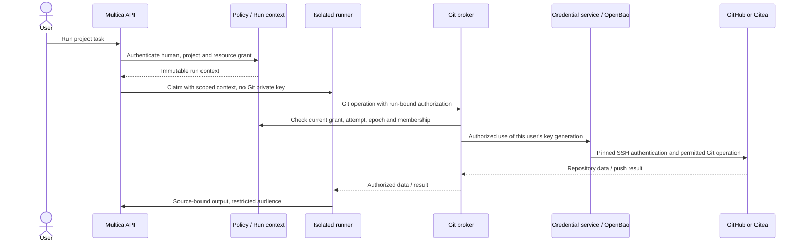

# Per-user Git credentials — implementation plan

**Decision date:** 2026-10-16 (Asia/Ho_Chi_Minh)  
**State:** architecture direction accepted; implementation and production enablement are not complete.  
**Feature tracker:** [#84](https://github.com/r2d-ai/multica/issues/84)  
**Patch-stack / upstream cursor:** [#12](https://github.com/r2d-ai/multica/issues/12)  
**Planning baseline:** `231dedb55287ab6e40fd103634a024e4d9d1baeb`.  
**Delivery:** commits and PRs on `r2d-ai/multica` only; upstream is read-only reference.

## 1. Quyết định đã chốt

Mỗi user tạo một SSH key pair chuyên dụng cho từng Git provider instance trong profile của mình. Backend tin cậy tạo key; UI chỉ hiện **public key + fingerprint** để user copy vào tài khoản GitHub/Gitea của chính họ. Không import private key cá nhân đang dùng, không có nút reveal/export, không trả private key qua bất kỳ user/admin API nào.

Private key không phải một field bị CSS che trong profile. Nó nằm trong secret store mã hóa; database ứng dụng chỉ giữ metadata và tham chiếu nội bộ. Chỉ credential service/SSH transport tin cậy được sử dụng key. Coding agent, daemon executor và subagent không nhận key hay socket SSH ký tùy ý.

Danh tính Git được chọn **theo người ủy quyền cho từng run**, không theo người tạo agent, người sở hữu runtime hay người tạo issue. Agent/squad vẫn là cấu hình dùng chung.

| Thành phần | Quyết định V1 |
| --- | --- |
| Key | Ed25519, tạo bằng CSPRNG ở backend, riêng user/provider; rotation có generation mới |
| Custody | OpenBao KV v2 qua credential service; không có plaintext/local-file fallback trong production |
| Git transport | Agent → broker có xác thực → GitHub/Gitea qua SSH bằng key đúng user |
| Grant | User hiện tại ∩ project ACL ∩ repo được project duyệt ∩ quyền run ∩ giới hạn agent |
| Execution | Linux-first, sandbox riêng; supervisor, broker và secret store nằm ngoài phạm vi agent |
| Delegation | Giữ nguyên authorizing user; quyền con là tập con quyền cha |
| Missing identity/runtime | Từ chối; không fallback sang key admin/shared/agent owner |
| Unsupported automation | Schedule/webhook/external channel bị chặn với protected Git ở V1 |

Không tạo key thật, thay credentials production, deploy runtime hay sửa branch protection trong PR kế hoạch này.

## 2. Baseline phải được đối chiếu trước

Tracker #12 mô tả R2D ACL stack cũ và cursor tháng 09/2026. Tại SHA baseline trên, hai đường dẫn `docs/r2d-extension-architecture.md` và `server/internal/r2dauth/execution.go` trả 404 khi đọc qua GitHub Connector. Không được coi lịch sử issue là bằng chứng lớp ACL đó vẫn hiện diện trên main hiện tại.

S0 phải inventory refs, migrations và seam authorization đang tồn tại; ghi riêng current main, lịch sử R2D và deployment chưa xác minh. Không reset main, khôi phục cả patch stack hoặc đổi mô hình ACL ngầm trong feature này. Nếu cần phục hồi ACL, tách thành prerequisite PR được review. Test/interface dùng fixture có thể bắt đầu, nhưng không bật protected project nếu chưa có policy adapter tin cậy.

Giữ nguyên guardrails của #12: `r2d_*` side tables, không sửa schema upstream, không FK vào bảng upstream, migrations trong `900000-999999`. **Chưa cấp số migration ở bước planning**; S0 inventory và ghi allocation vào #12 trước khi viết DDL. Theo AGENTS.md, mỗi concurrent index build là một migration riêng.

## 3. Luồng người dùng

### 3.1 Tạo và liên kết key

1. User mở **Profile → Git identities**, chọn provider từ catalog admin đã duyệt. Một Gitea host/port khác là một provider instance khác; không cho user biến ô này thành địa chỉ SSH tùy ý.
2. User bấm **Generate key**, xác nhận quyền sử dụng key cho các workspace/project được chọn. Backend xác thực human session, CSRF và recent-auth; không tin `user_id` do client gửi.
3. Credential service tạo key, lưu vào OpenBao, ghi metadata. UI nhận public key/fingerprint và trạng thái `pending_verification`.
4. User copy public key vào mục **SSH authentication keys** của tài khoản GitHub/Gitea. Không nhầm với signing key hay deploy key của một repo.
5. User bấm **Verify**. Backend kết nối đúng provider với host key đã pin, chứng minh key xác thực thành tài khoản nào, lưu account ID ổn định khi provider hỗ trợ và username snapshot để hiển thị.
6. Chỉ sau khi verification thành công mới chuyển thành `ready`. UI hiện tài khoản đã xác minh, fingerprint, thời điểm kiểm tra, nút Rotate/Revoke.

Không coi username tự gõ, nút "đã thêm key", hoặc exit code SSH bằng 0 là bằng chứng. GitHub có thể báo xác thực thành công nhưng exit code 1. Gitea adapter phải được test theo phiên bản hỗ trợ; banner thiếu/không đáng tin cậy phải để `unverified`, hoặc dùng luồng account-link có xác thực độc lập. Không đoán danh tính và không yêu cầu admin PAT chỉ để làm luồng dễ hơn.

**Verify account không đồng nghĩa được đọc mọi repo.** Provider repo ACL và project/run policy phải kiểm tra tại thời điểm sử dụng.

### 3.2 Chạy công việc



UI task hiển thị **Acting for**, provider account, allowed repository, runtime và trạng thái thiếu quyền; không hiển thị secret reference. Project creator, assignee người hay display name của agent không quyết định credential.

### 3.3 Rotation và revoke

Rotation tạo generation mới ở trạng thái pending; user đăng ký và verify nó trước khi activate. Việc activate là thay đổi atomic trong metadata: generation cũ mất quyền sử dụng, lease cũ bị thu hồi. Run đang cần Git phải lấy grant mới sau revalidation; không tự giữ key cũ.

Revoke chặn sử dụng ngay ở policy/credential layer, sau đó cleanup secret theo outbox có retry. OpenBao KV v2 soft-delete không phải phá hủy mọi version; cleanup phải xử lý đúng destroy/version semantics. UI nhắc user xóa public key cũ trên Git provider. Hai hệ thống không có transaction chung; phải phân biệt **locally revoked**, **secret cleanup pending** và **provider removal pending**.

Backup/restore không được làm sống lại một generation đã revoke: lưu tombstone/epoch có đối chiếu và yêu cầu reconciliation trước khi broker mở lại. Không hứa xóa được key/source đã bị lấy trước khi revoke.

## 4. Security contract của run

### 4.1 Context và grant

Các tên sau là contract đề xuất, chưa phải API đang có:

```text
RunSecurityContext
  id, task_id, attempt_id, root_context_id, parent_context_id
  authorizing_user_id, agent_id, runtime_id
  execution_workspace_id, resource_workspace_id, project_id
  originator_source, provenance_evidence, policy_epoch, state

RunRepositoryGrant
  id, context_id, provider_id, repository_id, identity_id
  credential_generation, operations, allowed_write_refs
  grant_epoch, issued_at, expires_at, revoked_at
```

Server tự resolve task → agent → issue/project → resource. Caller không được đổi principal, secret path, repo URL hoặc project bằng env/header/body. Các IDs dùng để tra dữ liệu tin cậy, không phải bằng chứng tự thân.

`originator_user_id` là nền tảng hiện có; `accountable_user_id` chỉ phục vụ audit khi không có quyền ủy quyền. Không cấp credential từ `owner_fallback`, `backfill`, `rule_owner` hay một chuỗi không chứng minh được root. Kiểm tra current membership và project policy không được bỏ qua vì task đã được xếp hàng trước đó.

Human có quyền project là điều kiện cần, **không đủ**: task phải có grant repo/operation rõ ràng. Điều này giữ nguyên nguyên tắc P06 rằng task token không tự thừa hưởng toàn bộ quyền của owner human.

### 4.2 Delegation và tiếp tục công việc

| Trigger | Contract |
| --- | --- |
| A trực tiếp run/assign/chat/comment | Root làm thay A sau kiểm tra quyền |
| Agent của A gọi agent/squad/subissue | Child vẫn A, grant không rộng hơn cha, lease riêng |
| Reviewer do admin sở hữu | Không được lấy key hoặc quyền admin |
| Native subagent cùng process/sandbox | Cùng security domain; muốn read-only thật phải sandbox/grant riêng |
| Auto-retry | Giữ A, attempt/lease mới, revalidate quyền và policy |
| B bấm rerun/tiếp tục issue | Context và native session mới cho B; không tiếp quản A |
| Parent hoàn thành bình thường | Child đã được ủy quyền có thể tiếp tục trong grant còn hiệu lực |
| Root bị cancel/revoke | Thu hồi toàn bộ grant chain và dừng descendant liên quan |
| Schedule/webhook chưa có consent contract | Protected Git bị từ chối ở V1 |

Chuỗi phải cùng principal và đúng execution/resource scope được chứng minh. Chặn cycle, độ sâu quá mức, task giả/mất, task-agent mismatch và thay đổi danh tính ở giữa. Nếu workflow chuyển project, cần grant mới được server xét; không mặc định chuyển quyền theo câu text của agent.

Tách thông tin bất biến về nguồn gốc với kiểm tra quyền hiện tại. Parent đã hoàn thành không phải bằng chứng vô hiệu cho một child được tạo hợp lệ; nhưng không được dùng một task cũ đã hết quyền để tạo delegation mới.

### 4.3 Lease

Lease chỉ dành cho broker, gắn context/attempt/repo/operation/generation và kênh runner đã xác thực. Không phải Multica admin token. Ngay cả khi agent có thể dùng lease của chính run, nó không được dùng để truy cập repo khác, đổi user hoặc phát key.

Mục tiêu TTL tối đa 5 phút; broker vẫn phải kiểm tra epoch/state trực tuyến. TTL ngắn không thay thế revoke. Đừng giữ daemon identity hoặc khóa dùng ký run-grant trong sandbox. Mất policy authority, hết hạn hoặc epoch không khớp đều deny.

## 5. Data model và API

### 5.1 Side tables

| Proposed table | Dữ liệu chính |
| --- | --- |
| `r2d_git_provider` | Kind, canonical host/port/user/API authority, host-key pins, config epoch, enabled |
| `r2d_user_git_identity` | User/provider, verified external account ID, login snapshot, active generation, enrollment scope |
| `r2d_user_git_key` | Identity, generation, public key, fingerprint, internal secret reference, state/timestamps |
| `r2d_git_project_repo` | Canonical project/resource/provider/repo binding, read/write/ref policy, classification |
| `r2d_git_run_context` | Immutable principal/provenance/context plus lifecycle state |
| `r2d_git_run_grant` | Per-run allowed repo/operation/ref/credential generation, epochs and expiry |
| `r2d_git_security_event` / `r2d_git_security_outbox` | Durable audit intent/outcome, revoke and cleanup work |

Logical references được validate trong code và transaction; không thêm FK/cascade trái repository rules. Constraint uniqueness phải xử lý generate/verify/rotate concurrent và chỉ có một active generation cho mỗi identity. Không dùng username/path làm identity key. Đặt unique indexes bằng migration riêng, không giả định số migration chưa được cấp.

DB transaction không bao trùm OpenBao hay Git provider. Generate/store/activate/destroy/push cần idempotency key, durable intent và reconciliation. Lỗi giữa chừng không được tạo "ready" metadata cho secret chưa tồn tại hay để orphan key có thể dùng.

### 5.2 Proposed HTTP surface

| Endpoint family | Contract |
| --- | --- |
| `GET /api/me/git-identities` | Metadata + public key của chính user; account-scoped query key |
| `POST /api/me/git-identities` | Tạo key family/generation cho approved provider; owner từ session |
| `POST /api/me/git-identities/{id}/verify` | Prove provider identity, không clone repo bằng admin |
| `POST /api/me/git-identities/{id}/rotate` | Tạo pending generation; không thay active key trước verify |
| `POST /api/me/git-identities/{id}/activate` | Activate verified generation, revoke epoch cũ |
| `POST /api/me/git-identities/{id}/revoke` | Disable local use ngay; trả cleanup/provider-removal status |
| Internal grant/transport endpoints | Chỉ workload channel có xác thực; bind user từ context server |
| Restricted run-output endpoints | Current project/source access, không dùng workspace-read đơn thuần |

Không có `/private-key`, `/reveal`, `/export` hoặc API đọc secret theo path do caller cung cấp. Recent-auth policy phải khả thi với login hiện có; nếu thiếu primitive, S0 xác định prerequisite, không bỏ qua. Quản trị viên có thể cấu hình provider/disable credential theo security policy nhưng không được thao tác Git giả danh user qua profile endpoints.

Trả lỗi có code rõ ràng như `git_identity_required`, `git_identity_unverified`, `git_principal_unproven`, `git_repo_forbidden`, `git_runtime_ineligible`, `git_grant_revoked`, `git_provider_unavailable`. Sanitization tránh biến lỗi thành oracle về repo/account của người khác. API schemas/malformed-response tests bắt buộc; không persist secret hay server-state vào Zustand/localStorage.

## 6. Git broker và quyền repository

Preferred transport: Git smart-HTTP phía sandbox, SSH phía provider. Đây là bridge có policy, không phải proxy mù. S3 phải làm spike đọc/ghi một repo trước; remote-helper là lựa chọn tương thích nếu được ghi nhận rõ, không thay đổi trust contract.

**Read path:** authorize → prove current repo access với key đúng user → fetch/serve dữ liệu được phép. Cache hit vẫn đi qua kiểm tra quyền. Không dùng SSH login thành công như bằng chứng quyền repo; không phục vụ cache riêng tư khi provider proof đã stale/không có.

**Write path:** nhận thay đổi vào quarantine không secret → kiểm tra object/ref trong subprocess hạn chế → revalidate policy/generation → push exact permitted refs bằng user key → đối chiếu remote kết quả. Mặc định chỉ tạo/cập nhật feature branch được cấp cho task. Chặn default/protected branch, tag, delete, force/mirror và repo ngoài grant. Provider branch protection vẫn có hiệu lực.

Không chạy credential-bearing Git trong `.git` do agent kiểm soát; không load host/global config, hooks, filters, helpers, SSH ProxyCommand hoặc URL rewrite từ run. Sandbox không có generic signer socket. Worker xử lý Git input không tin cậy phải tách khỏi key service; privileged transport chỉ nhận structured canonical operation, không nhận shell command của agent.

Provider catalog quyết định host/port/pins/path, có xử lý SSRF/DNS/redirect theo authority. Internal Gitea được allowlist cụ thể, không mở mọi private IP. Tắt forwarding/SSH multiplex reuse giữa user. Connection/session identity phải độc lập với display name, environment hoặc client URL.

Repo chính không tự cấp quyền cho submodule/LFS/dependency repo. Inventory trước rollout; V1 không hỗ trợ đường nào thì fail rõ ràng trước khi báo thành công. Không mở HTTPS credential fallback cho LFS để "cho build chạy".

SSH authentication, Git author/committer metadata, commit signing và PR/API auth là bốn chuyện khác nhau. V1 không giả vờ SSH key giúp `gh pr create` xác thực. Khi chưa có adapter API scoped theo user, báo unavailable; tuyệt đối không dùng workspace/admin PAT. Signing độc lập và không giả chữ ký của user để qua merge gate.

## 7. Runtime, cache và source output

### 7.1 Execution boundary

Linux-first trên dedicated worker VM. Pilot dùng hardened container/run: non-root, user/mount/PID/network isolation, no-new-privileges, dropped capabilities, seccomp/AppArmor, giới hạn CPU/RAM/disk/time và read-only base. Workload nhạy cảm hoặc mutually hostile phải dùng VM/microVM theo đánh giá, không gọi shared kernel là ranh giới tuyệt đối.

Supervisor/container-engine socket, broker credentials, OpenBao, database/control-plane token, host HOME và SSH sockets không được mount vào run. Không chấp nhận runtime tự khai "secure" mà chưa được operator đăng ký/certify. Old daemon không advertise contract hoặc provider launch path chưa hỗ trợ phải từ chối protected run.

Audit đủ prepare → checkout → execute → resume → finalize/push → collect artifact → cleanup. Đừng chỉ sandbox coding CLI trong khi daemon clone trước hoặc push sau bằng ambient credential. `repocache.gitEnv()` cũ không được dùng cho protected repositories.

Native CLI/provider credentials phải là scoped/per-user hoặc qua gateway được kiểm soát; không mount login files chứa quyền chung. Mỗi coding provider cần acceptance riêng. CI dùng fake CLI; real model/provider smoke cần ủy quyền rõ ràng.

### 7.2 Cache/session partition

Cache key tối thiểu gồm user + project + provider/repo + policy generation. Workdir và native session còn bind runtime/attempt/context. Không chia sẻ writable common Git dir, alternates hoặc raw objects giữa user. Source đã cached cũng là source nhạy cảm.

Có thể tối ưu disk bằng backend dedup/reflink không expose object pool hoặc quyền ghi chung, sau khi test isolation. Không coi worktree directory riêng là đủ: linked worktrees chia sẻ repository metadata. Handoff giữa user dùng commit/patch được xét quyền, không chuyển memory/session/raw workdir mặc định.

### 7.3 Output và đường vòng

Run có source gắn source classification từ server grant. Transcript, tool result, diff, generated code, artifacts, file preview, memory/search và download chỉ được mở khi user còn project và repository access. Multi-repo run mặc định giữ union classification; reader cần quyền với toàn bộ nguồn liên quan.

Kênh issue có progress-only viewers chỉ nhận trạng thái có cấu trúc do server tạo. Không đăng narrative tự do do LLM sinh rồi tin nó không chứa code. Narrative/source detail ở restricted run view; declassification cần luồng riêng được phê duyệt.

Áp dụng cả HTTP, WS đang mở, notifications/email, export, MCP, attachment links và generic comment APIs của agent. Protected task tokens không được dùng endpoint chung để đăng source ra audience rộng hơn. Model/package/network egress phải được giới hạn; hostname allowlist đơn thuần không chặn upload vào tài khoản/repo khác trên cùng host.

Không thể hứa source không bao giờ bị sao chép sau khi đã được giao cho run/user được phép. Ranh giới mục tiêu là ngăn vượt quyền và giảm đường exfiltration, không phải thu hồi dữ liệu đã được đọc hay bảo vệ trước host-root/hypervisor/control-plane compromise.

## 8. Revocation và audit

Mục tiêu nghiệm thu (chưa phải khả năng đang có):

- Local revoke đã acknowledge: không chấp nhận operation mới; active stream/sandbox bị dừng trong tối đa 5 giây qua cơ chế đã test.
- Lease TTL tối đa 5 phút, nhưng mỗi operation vẫn kiểm tra current state/epoch.
- External Git ACL change: check trước Git/cache delivery, dùng provider events nếu đủ tin cậy; long-lived source sessions kiểm tra định kỳ với target tối đa 60 giây. Nêu rõ detection bound đo được, không gọi đây là immediate revoke ở provider.
- Sau offboard/project change/key rotation/root cancel: thu hồi descendants, native resume và future output access. Provider/policy mất kết nối hoặc proof stale: deny, không tiếp tục dùng dữ liệu cached như không có gì.

Audit ghi actor human + agent, task/attempt/root, provider/repo, fingerprint, operation/ref, decision, timestamps và outcome. Không ghi private key, bearer token hoặc raw source vào routine logs. Durable intent phải có trước mutation. Push thành công rồi mất response/audit-write là `indeterminate`, phải reconcile remote ref và outcome; không retry mù.

OpenBao KV chỉ là secret storage, không phải authorization broker và không mặc định là non-exportable HSM. Trusted credential worker vẫn có thể cần key plaintext trong bộ nhớ. Memory wiping trong Go là best effort, không được cam kết tuyệt đối. Tách quyền quản trị worker, broker và secret store, hạn chế dump/swap và ghi audit custody. Operator có quyền root trên trust domain vẫn là residual risk phải công khai.

## 9. Work packages và thứ tự triển khai

| Slice | Issue | Deliverable | Dependency |
| --- | --- | --- | --- |
| S0 | [#85](https://github.com/r2d-ai/multica/issues/85) | Reconcile ACL baseline, policy/context contract, migration inventory, red tests | Đầu tiên |
| S1 | [#86](https://github.com/r2d-ai/multica/issues/86) | Profile key UI/API, OpenBao custody, verify/rotate/revoke | S0 |
| S2 | [#87](https://github.com/r2d-ai/multica/issues/87) | Principal + explicit grant + delegation/attempt semantics | S0 |
| S3 | [#88](https://github.com/r2d-ai/multica/issues/88) | Git broker, user SSH identity, repo/ref enforcement | S1 + S2 |
| S4 | [#89](https://github.com/r2d-ai/multica/issues/89) | Isolated runner, cache/native-session boundaries | S0; integrate S2/S3 |
| S5 | [#90](https://github.com/r2d-ai/multica/issues/90) | Source-output/API/MCP bypass closure, revocation/audit | S2 + S3 + S4 |
| S6 | [#91](https://github.com/r2d-ai/multica/issues/91) | Adversarial end-to-end evidence, migration/rollback, gated rollout | S1-S5 |

Sau S0, S1/S2 và skeleton S4 có thể làm song song. S3 phát triển trên interfaces đã chốt; integrated acceptance đợi S4. Không PR nào được dùng việc merge UI làm bằng chứng feature hoàn tất. Một slice có thể tách PR nhỏ hơn nhưng mỗi PR phải nêu gate còn thiếu.

### Integration map

Các đường dẫn hiện có đã được dùng trong research ở baseline: `server/internal/attribution/attribution.go`, `server/internal/daemon/repocache/cache.go`, `server/internal/daemon/types.go`, `server/internal/handler/daemon.go`, task enqueue/service paths và `apps/docs/content/docs/security-model.mdx`.

Đề xuất code mới đặt tại `server/internal/r2dgit/` (policy, identity, custody, broker), handler adapters `r2d_git_*`, `r2d_*` SQL queries/side tables và runner adapter riêng. UI trong `packages/views/`, headless schemas/queries trong `packages/core/`. Đây là proposed locations, không khẳng định đã tồn tại. S0 xác định project ACL adapter từ code thật, không import `r2dauth` đang thiếu rồi để agent tự chế fallback.

Giữ hook nhỏ trong enqueue/claim/daemon/repocache và dùng capability handshake cho installed clients. Không sửa toàn bộ provider adapters trong một PR; runtime chưa có test protected path không được nhận protected run.

## 10. Acceptance matrix và release gates

Fixture chuẩn: user A/B, admin-owned shared agent/squad, repo chung và repo chỉ A được đọc, hai SSH key khác nhau, disposable Git/SSH server, broker/OpenBao test environment và isolated fake-CLI runners.

| Test | Kết quả bắt buộc |
| --- | --- |
| Cùng agent chạy A/B đồng thời | Đúng provider identity, không lẫn key/cache/session |
| B đọc repo A đã warm cache | Bị chặn cả checkout/raw objects/file preview |
| A gọi admin-owned subagent | Vẫn grant A, không tăng quyền |
| B tiếp tục issue của A | Không lấy lease/native history/workdir của A |
| Forged header/task/project/attempt | Deny qua real router/claim/broker, không chỉ unit helper |
| Hooks/config/URL/LFS/submodule/remote helper | Không lấy secret hoặc đi tới repo/host ngoài grant |
| Git/API/MCP credential bypass | Không có admin credential hoặc route thay thế |
| Revoke khi SSH/WS đang mở | Dừng future delivery theo latency đã đo, không cần reconnect |
| Key rotate/restore/crash/retry | Generation cũ không sống lại, operation không retry mù |
| Old daemon/unsupported provider | Từ chối protected execution |
| Output to progress-only viewer | Không có source qua comments/email/search/export/download |
| Secret scan | Không có private key trong API/DB metadata/browser/log/task/daemon files |

Mỗi test có regression/negative control cho thấy nó bắt được cơ chế sai. Independent reviewer khác implementer kiểm tra identity, custody, runtime/data boundary và revoke. Real GitHub/Gitea smoke chỉ dùng repo/branch được cho phép; real coding CLI test tuân thủ `agentintegration` và authorization trong AGENTS.md.

### Rollout

1. Inventory deployment SHA, ambient SSH/HTTPS/CLI/MCP secrets, cache/session cũ; không đưa secret vào tracker.
2. Chuẩn bị secret store/broker và isolated workers. Remove/rotate admin credentials theo lịch operator phê duyệt; không tự revoke credential ngoài scope.
3. Deploy daemon/server có capability; onboarding hai user với repo test.
4. Chỉ enable protected pilot project sau S0-S5 và security gate; LFS/submodules/signing/API needs phải được inventory trước chọn repo.
5. Chạy S6, đo deny/error/revocation lag/disk/startup, review rồi mở rộng.

Rollback là pause protected runs, revoke leases, giữ dữ liệu dưới ACL và sửa lỗi. Không bật lại shared admin key, không hạ protected project sang ambient auth. Thay đổi enforcement cần audited operator approval. Existing legacy projects chỉ được giữ trong môi trường legacy tách biệt chưa tuyên bố an toàn; chúng không được tiếp cận broker/keys/cache của protected mode.

## 11. Reference và backport cursor

Đây là các nguồn để đọc thiết kế, không phải dependency được merge tự động:

- [Upstream #1976](https://github.com/multica-ai/multica/issues/1976): per-repo/per-agent SSH request; không dùng agent name/key path làm security boundary.
- [Upstream #8494](https://github.com/multica-ai/multica/issues/8494): per-member runtime routing gap; có fork report nhưng không coi mô tả là code đã audit.
- [Upstream #7441](https://github.com/multica-ai/multica/pull/7441): task identity tokens/lineage tests; unmerged reference tại lượt research, phải recheck head trước port.
- [Upstream #8107](https://github.com/multica-ai/multica/pull/8107): acting-human authorization/trusted actor headers; xem implementation hiện tại trước backport.
- [Baseline repocache](https://github.com/r2d-ai/multica/blob/231dedb55287ab6e40fd103634a024e4d9d1baeb/server/internal/daemon/repocache/cache.go): ambient daemon Git environment.
- [Baseline attribution](https://github.com/r2d-ai/multica/blob/231dedb55287ab6e40fd103634a024e4d9d1baeb/server/internal/attribution/attribution.go): authorization human vs audit human.
- [Baseline security model](https://github.com/r2d-ai/multica/blob/231dedb55287ab6e40fd103634a024e4d9d1baeb/apps/docs/content/docs/security-model.mdx): outer execution boundary is required.
- [GitHub SSH key registration](https://docs.github.com/en/authentication/connecting-to-github-with-ssh/adding-a-new-ssh-key-to-your-github-account): authentication key vs signing key.
- [GitHub SSH verification](https://docs.github.com/en/authentication/connecting-to-github-with-ssh/testing-your-ssh-connection): provider-specific success behavior.
- [OpenBao KV v2](https://openbao.org/docs/secrets/kv/kv-v2/): versions, CAS, soft-delete and destroy.
- [OpenBao threat model](https://openbao.org/docs/internals/security/): limits of trusted-host protection.
- [Git worktree](https://git-scm.com/docs/git-worktree): shared metadata/config semantics.

Sau mỗi implementation/backport PR, cập nhật #84 với slice/PR/SHA/test/gate/next action và #12 với patch/migration/upstream cursor. Không thay con số checked SHA thành synced/merged SHA khi chưa sync. Handoff cho coding agent: [git-security-agent-handoff.md](git-security-agent-handoff.md).
